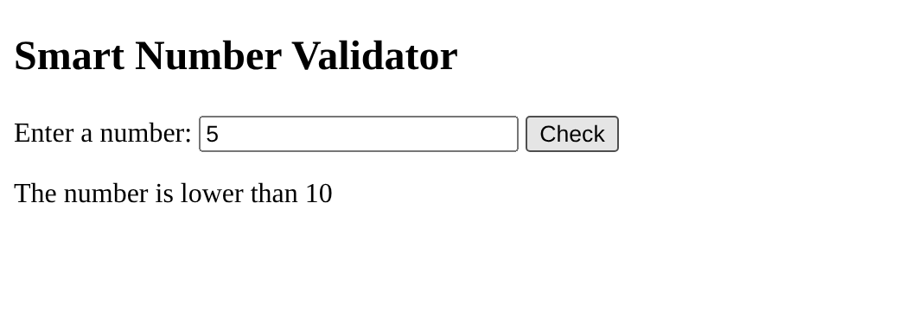
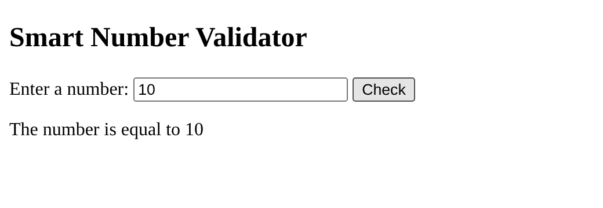
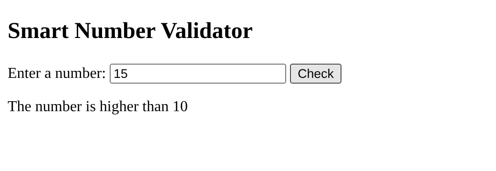
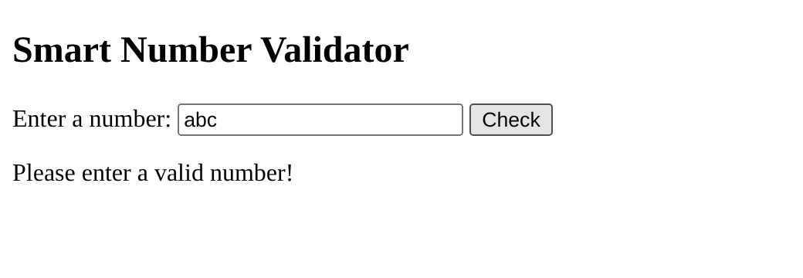
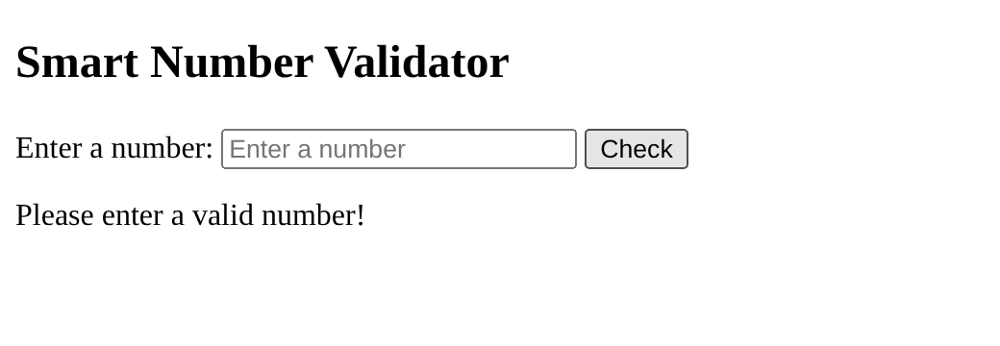
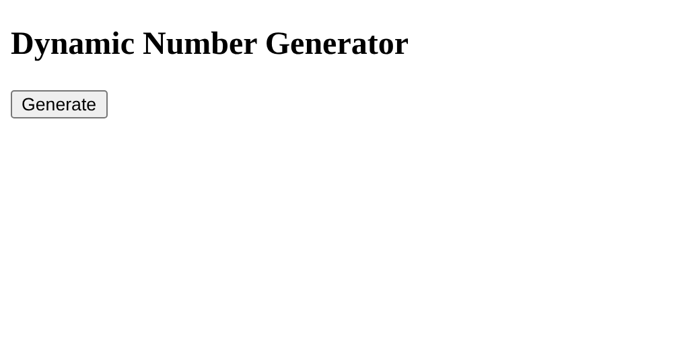

# BIC21203 Lab 4a – JavaScript

**Name:** Muhammad Imaduddin bin Sumail
**Matric No:** AI240041

## Description
- **Q1:** Changes the paragraph text to "Hello there!" when the button is clicked.
- **Q2:** Checks if the number entered is lower, higher or equal to 10, and rejects invalid input.
- **Q3:** Generates a numbered list from 1 to 5 using a for loop.

## How to Run
Open `Q1/index.html`, `Q2/index.html` or `Q3/index.html` in any browser.

## Screenshots
### Q1

### Q2

### Q3

