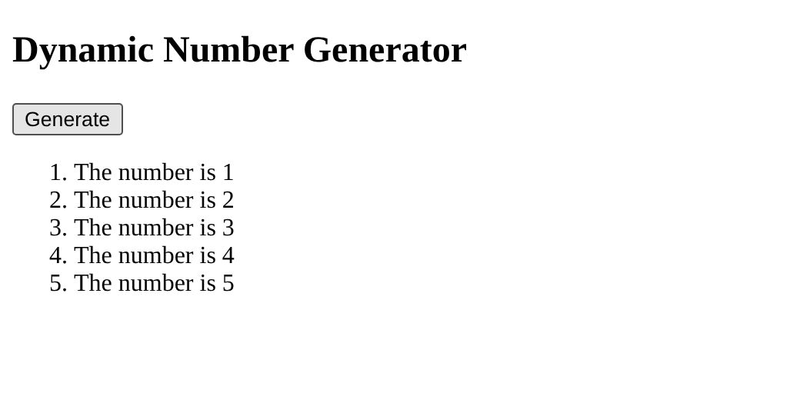

# BIC21203 Lab 4a – JavaScript

**Name:** Muhammad Imaduddin bin Sumail

**Matric No:** AI240041

## Description
- **Q1:** Changes the paragraph text to "Hello there!" when the button is clicked.
- **Q2:** Checks if the number entered is lower, higher or equal to 10, and rejects invalid input.
- **Q3:** Generates a numbered list from 1 to 5 using a for loop, without duplicates on repeated clicks.

## Files

| Folder | Question | Description |
|--------|----------|-------------|
| `Q1/index.html` | Q1 | Interactive Text Changer – `changeMessage()` with `addEventListener()` |
| `Q2/index.html` | Q2 | Smart Number Validator – `checkInput()` with `if...else if...else` |
| `Q3/index.html` | Q3 | Dynamic Number Generator – `generateNumbers()` with a `for` loop and `createElement()` |

## How to Run
1. Clone or download this repository.
2. Open `Q1/index.html`, `Q2/index.html` or `Q3/index.html` in any modern browser (double-click or use VS Code Live Server).
3. No external libraries are needed.

## Screenshots

### Q1 – Interactive Text Changer
**Before clicking**

**After clicking "Change Message"**

### Q2 – Smart Number Validator
**Input: 5**

**Input: 10**

**Input: 15**

**Input: abc**

**Input: empty**

**Input: 10.5 (decimal)**

### Q3 – Dynamic Number Generator
**Before clicking**

**After clicking "Generate"**

**After clicking "Generate" 3 times (no duplicates)**

