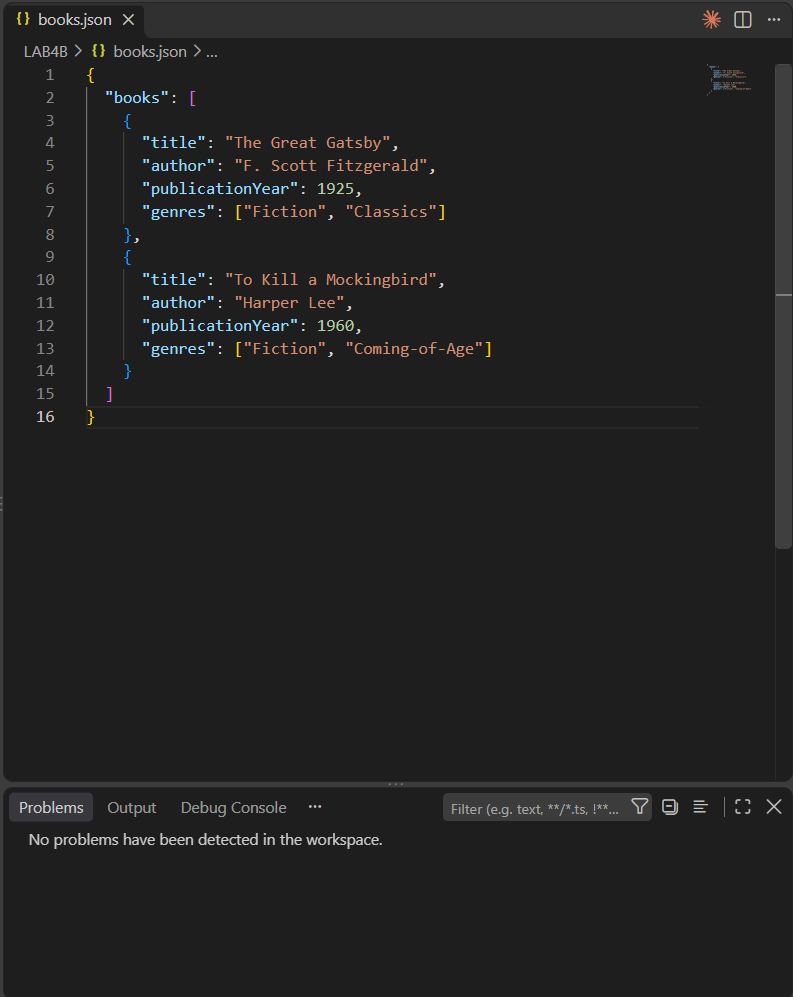
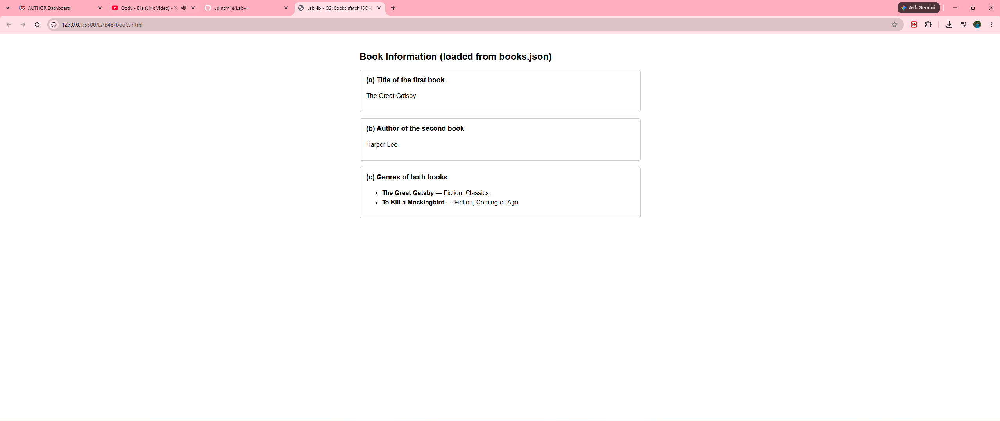
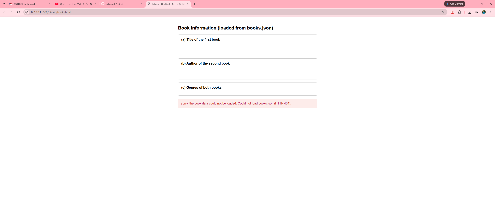
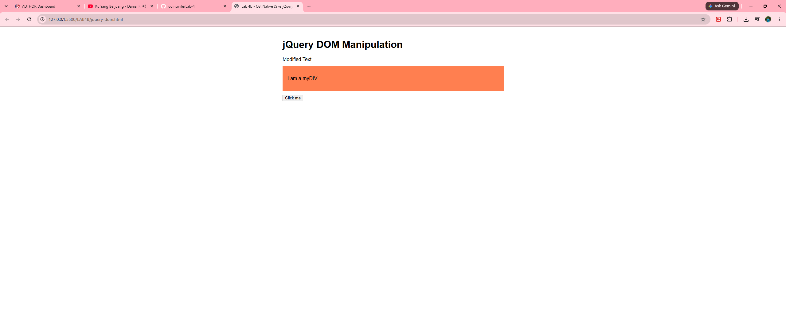
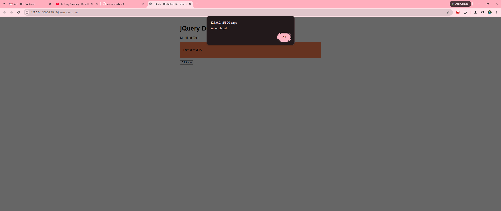

# Lab 4b – Client-Side Scripting (JSON and jQuery)

BIC21203 Web Development · Academic Session 2026/2027
Muhammad Imaduddin bin Sumail (AI240041)

## Files

| File | Question | Description |
|------|----------|-------------|
| `books.json` | Q1 | JSON dataset with a top-level `books` array of two book objects |
| `books.html` | Q2 | Loads `books.json` with `fetch()` and displays the required data, with error handling |
| `jquery-dom.html` | Q3 | jQuery 4.0.0 equivalents of three native JavaScript DOM/event operations |

## Setup

1. Clone the repository and open the folder in VS Code.
2. Install the **Live Server** extension (Ritwick Dey).
3. Right-click `books.html` → **Open with Live Server**.
   > Do not open it via `file://` — browsers block `fetch()` on local files.
4. Open `jquery-dom.html` the same way (internet needed to load jQuery from the CDN).

## Screenshots

### Q1 – books.json (valid, no problems detected)

### Q2 – books.html output

### Q2 – Error handling (file not found)

### Q3 – jQuery DOM changes

### Q3 – Click event
